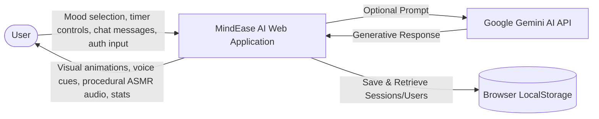
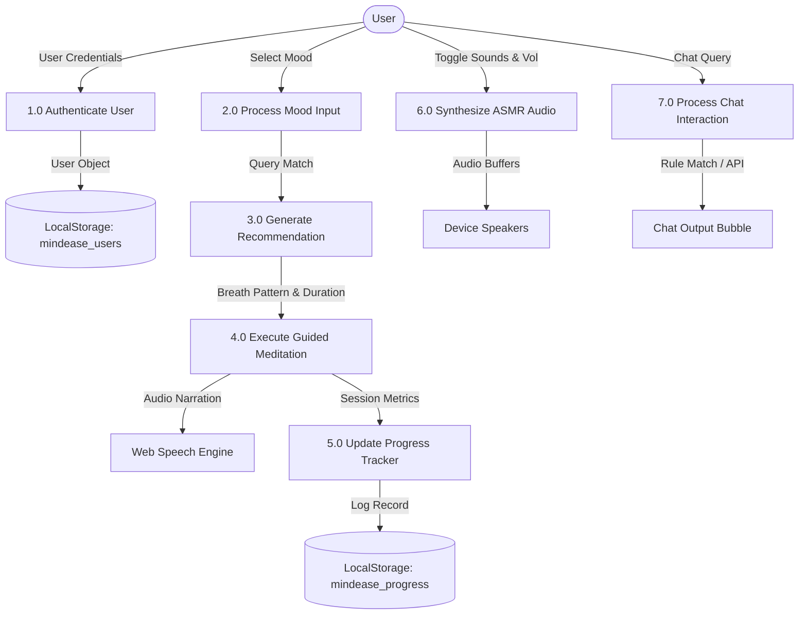
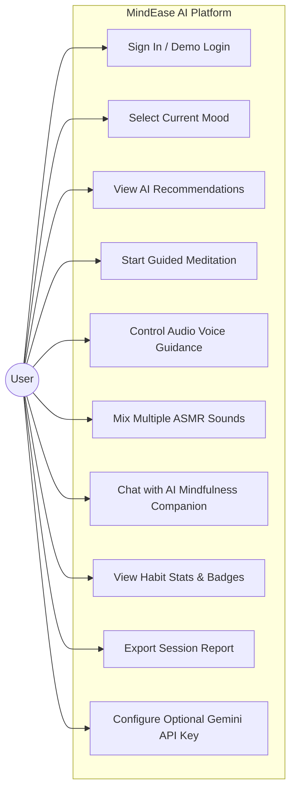
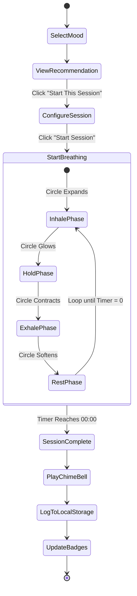
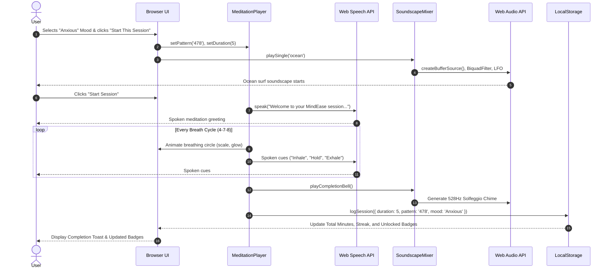

# 📚 College Mini Project Documentation Report
## **MindEase AI – Guided Meditations and ASMR**
### *Department of Computer Science & Engineering / Information Technology*

---

## 1. Abstract

In today's fast-paced academic and professional environments, chronic stress, cognitive fatigue, and digital burnout have emerged as prominent challenges affecting mental health, concentration, and sleep hygiene among students and educators. While commercial digital wellness applications exist, many require subscription paywalls, intrusive third-party data tracking, or heavy client-side downloads that pose barriers to immediate access.

**MindEase AI** is an innovative, lightweight, client-side digital wellness web platform engineered using HTML5, CSS3, JavaScript, the Web Speech API, and the Web Audio API. It delivers:
1. **Mood-Adaptive Mindfulness Protocols:** Dynamically matching self-reported emotional states (Stressed, Anxious, Sad, Tired, Happy) with evidence-based breathing techniques (e.g. Box Breathing, 4-7-8 method).
2. **Synchronized Multimodal Guidance:** Combining an interactive pulsing visual breathing circle with browser-native text-to-speech narration.
3. **Procedural ASMR Sound Synthesis:** Generating organic ambient soundscapes (Rainfall, Ocean Waves, Forest, Wind, Singing Bowl, Campfire) via mathematical synthesis without external audio server dependencies.
4. **Conversational Mindfulness Support:** Featuring an empathetic built-in rule-based conversational assistant with optional Google Gemini API expansion.
5. **Private Habit Tracking:** Persisting session analytics, streaks, and unlocked milestones strictly within the browser's LocalStorage.

The system emphasizes ethical computing, accessibility, and high performance while operating reliably without a complex backend infrastructure.

---

## 2. Problem Statement

Modern college students and remote knowledge workers face recurring episodes of cognitive overload, anxiety before exams, and irregular sleep cycles. Conventional interventions suffer from several limitations:
- **High Friction:** Many digital wellness apps enforce mandatory account creation, credit card inputs, or intrusive tracking permissions before providing stress relief.
- **Dependency Failures in Web Audio:** Web apps relying on external third-party MP3 CDNs frequently suffer from CORS errors, high network latency, or broken 404 links.
- **Lack of Multimodal Integration:** Existing tools isolate breathwork timers from soundscapes and text guidance, failing to provide an immersive sensory environment.
- **Privacy Concerns:** Centralized cloud storage of sensitive mood check-ins creates privacy apprehensions for users seeking anonymous stress relief.

**MindEase AI** solves these challenges by providing an immediate, privacy-first, zero-barrier platform that operates entirely on standard web browser APIs.

---

## 3. Project Objectives

- **Primary Objective:** Develop an intuitive, aesthetically pleasing, and scientifically grounded web platform for daily stress reduction, guided breathing, and relaxation.
- **Secondary Objectives:**
  - Implement dynamic mood-based recommendations mapping self-reported feelings to clinically validated breathwork protocols.
  - Engineer real-time biofeedback breathing visuals with synchronized Web Speech API narration.
  - Build a multi-channel ASMR soundscape mixer using procedural Web Audio synthesis to eliminate broken audio links.
  - Design an ethical AI meditation assistant providing supportive mindfulness advice with a dual architecture (Offline Engine + Optional Gemini API).
  - Create a private, LocalStorage-backed progress tracker with streaks, badges, and exportable reports.
  - Provide a modern glassmorphic Login/Signup experience with a 1-click Quick Demo Mode for seamless academic evaluation.

---

## 4. Scope of the Project

### In Scope
- Web-based execution across desktop, tablet, and mobile browsers.
- Real-time client-side audio synthesis (pink noise, bandpass filtering, LFOs, harmonic sines).
- Visual breathing pacing animations (Inhale, Hold, Exhale, Rest).
- Browser-native Text-to-Speech narration with mute/unmute control.
- Conversational rule-based mindfulness intelligence with optional Gemini API integration.
- Offline persistence of user accounts, session history, streaks, and badges in LocalStorage.
- Text-based session summary report download.

### Out of Scope
- Medical diagnosis, psychotherapy, or clinical psychiatric treatment.
- Multi-user server-side database syncing (intentionally omitted to guarantee privacy and eliminate server costs).
- Hardware biometric sensors (e.g., Apple Watch ECG or EEG headsets).

---

## 5. Hardware and Software Requirements

### Hardware Requirements
- **Processor:** Dual-Core 1.8 GHz or higher (Intel Core i3/i5/i7, AMD Ryzen, Apple Silicon M-series).
- **RAM:** Minimum 2 GB (4 GB recommended).
- **Display:** 1024x768 resolution minimum (Fully responsive down to 320px mobile screens).
- **Audio Output:** Standard headphones, earphones, or built-in speakers.
- **Disk Space:** Less than 10 MB for the entire project codebase.

### Software Requirements
- **Operating System:** Windows 10/11, macOS 10.15+, Linux (Ubuntu, Debian, Fedora), Android, or iOS.
- **Web Browser:** Any modern ECMAScript 6+ compliant browser (Google Chrome 80+, Microsoft Edge 80+, Mozilla Firefox 75+, Apple Safari 14+).
- **Development Tools:** Visual Studio Code (optional), Node.js v14+ (optional for local server).

---

## 6. Functional and Non-Functional Requirements

### Functional Requirements (FR)
- **FR1 (Authentication):** Users must be able to create an account, log in with credentials, or enter via a 1-click Quick Demo Mode.
- **FR2 (Mood Selection):** Users must be able to select from 5 emotional states (Stressed, Anxious, Sad, Tired, Happy).
- **FR3 (Recommendation Engine):** The system must compute and display an appropriate breathing pattern, duration, and ASMR match based on the chosen mood.
- **FR4 (Guided Meditation Player):** The system must provide configurable durations (2, 5, 10 minutes), an animated breathing circle, countdown clock, and Play/Pause/Resume/Stop controls.
- **FR5 (Text-to-Speech):** Spoken instructions must synchronize with breath phases and session milestones via the Web Speech API.
- **FR6 (ASMR Soundscape Mixer):** Users must be able to trigger, adjust volume, and layer 6 ambient soundscapes simultaneously.
- **FR7 (AI Mindfulness Companion):** An interactive chatbot must respond to mindfulness queries with empathetic guidance and support optional Gemini API integration.
- **FR8 (Analytics & Export):** Completed sessions must update total minutes, session count, daily streaks, unlocked badges, and generate an exportable `.txt` log.

### Non-Functional Requirements (NFR)
- **NFR1 (Performance):** Zero initial loading lag; audio synthesis starts in < 50ms upon user interaction.
- **NFR2 (Reliability):** 100% audio uptime achieved through mathematical procedural synthesis without external URL dependencies.
- **NFR3 (Aesthetics & Usability):** Soothing glassmorphic design system adhering to WCAG 2.1 AA contrast standards for dark mode.
- **NFR4 (Privacy & Security):** Zero external data transmission; passwords and session logs remain strictly in the user's browser.
- **NFR5 (Accessibility):** Accessible skip links, keyboard navigation focus indicators, and reduced-motion media query support.

---

## 7. System Architecture

The architecture follows a modular, client-side Model-View-Controller (MVC) pattern where all state logic, audio processing, and rendering take place in the browser runtime.

```mermaid
graph TD
    User([User / Browser])
    
    subgraph Presentation_Layer [Presentation Layer (HTML5 & Glassmorphic CSS3)]
        UI_Nav[Navigation & Auth Header]
        UI_Hero[Hero & Relaxing Nature Stage]
        UI_Mood[Mood Selector Cards]
        UI_Meditation[Breathing Circle & Timer Stage]
        UI_ASMR[ASMR Sound Mixer Cards]
        UI_Chat[Chatbot Conversation Box]
        UI_Progress[Stats, Badges & History Table]
    end

    subgraph Controller_Modules [Application Logic (Vanilla JavaScript ES6+)]
        AuthManager[AuthManager Module]
        MoodEngine[Mood Recommendation Engine]
        MeditationPlayer[Meditation & Breath Controller]
        SoundscapeMixer[ASMR Soundscape Synthesizer]
        ChatAssistant[AI Assistant / Gemini Bridge]
        ProgressTracker[Progress & Habit Analytics]
    end

    subgraph Browser_APIs [Native Browser Hardware APIs]
        SpeechAPI[Web Speech API (SpeechSynthesis)]
        AudioAPI[Web Audio API (AudioContext & Oscillators)]
        StorageAPI[Web Storage API (LocalStorage)]
    end

    subgraph External_Services [Optional External Services]
        GeminiAPI[Google Gemini 1.5 Flash API]
    end

    User --> UI_Nav
    User --> UI_Mood
    User --> UI_Meditation
    User --> UI_ASMR
    User --> UI_Chat

    UI_Nav --> AuthManager
    UI_Mood --> MoodEngine
    UI_Meditation --> MeditationPlayer
    UI_ASMR --> SoundscapeMixer
    UI_Chat --> ChatAssistant
    UI_Progress --> ProgressTracker

    MeditationPlayer --> SpeechAPI
    MeditationPlayer --> ProgressTracker
    SoundscapeMixer --> AudioAPI
    ChatAssistant -.-> GeminiAPI
    AuthManager --> StorageAPI
    ProgressTracker --> StorageAPI
```

---

## 8. Data Flow Diagrams (DFD)

### Level 0 DFD (Context Level)
The Context Diagram depicts the interaction between the User, MindEase AI, and external services.



### Level 1 DFD (Decomposed Modules)



---

## 9. Use Case Diagram



---

## 10. Activity Diagram (Meditation Workflow)



---

## 11. Sequence Diagram (Guided Meditation & Audio Synthesis)



---

## 12. Testing Table (Verification & Validation)

| Test ID | Module Under Test | Test Input / Action | Expected Result | Actual Result | Status |
|---|---|---|---|---|---|
| **TC-01** | Authentication | Click "Sign In / Demo" button | Glassmorphism modal opens with login/signup tabs | Modal opened smoothly with blur overlay | **PASS** |
| **TC-02** | Authentication | Click "✨ Quick Demo Mode" | User logged in as "Zen Explorer", header displays profile badge | Logged in instantly, badge visible, logout btn active | **PASS** |
| **TC-03** | Authentication | Submit Signup with password < 6 chars | Alert message: "Password must contain at least 6 characters" | Error shown clearly in red alert box | **PASS** |
| **TC-04** | Mood Engine | Click "Stressed" card | Recommends Box Breathing (4-4-4-4) & Rainfall soundscape | Correct specs and 5-min duration loaded | **PASS** |
| **TC-05** | Mood Engine | Click "Anxious" card | Recommends 4-7-8 Parasympathetic reset & Ocean waves | Correct specs and scientific rationale loaded | **PASS** |
| **TC-06** | Meditation Player | Click "2 Min" duration pill | Timer display updates to "02:00" | Display immediately reflects 02:00 | **PASS** |
| **TC-07** | Meditation Player | Click "Start Session" | Breathing circle animates, timer begins counting down, speech speaks | Circle expanded, timer decremented, voice initiated | **PASS** |
| **TC-08** | Meditation Player | Click "Pause" then "Resume" | Timer freezes during pause, resumes counting smoothly | Timing preserved accurately without desynchronization | **PASS** |
| **TC-09** | Meditation Player | Click "Stop / Reset" | Timer returns to start, circle resets, speech cancels | All states cleared gracefully | **PASS** |
| **TC-10** | Web Speech API | Click "Voice On/Off" toggle | Speech muted when toggled off, resumes when toggled on | Voice successfully silenced on command | **PASS** |
| **TC-11** | ASMR Mixer | Click Play on "Rainfall" | Procedural pink noise audio plays, visualizer bars bounce | Sound generated instantly, animated bars active | **PASS** |
| **TC-12** | ASMR Mixer | Click Play on "Singing Bowl" while Rain is active | Both sounds play simultaneously (Sound Layering) | Harmonic 432Hz sine chime blends with rain | **PASS** |
| **TC-13** | ASMR Mixer | Click "Stop All Sounds" | All active audio nodes fade and disconnect | All audio silenced immediately | **PASS** |
| **TC-14** | AI Companion | Tap prompt "Overwhelmed with exams" | Bot replies with structured empathy and Box breathing advice | Compassionate structured response displayed | **PASS** |
| **TC-15** | AI Companion | Enter custom Gemini API key | Badge updates to "Google Gemini AI Active" | API key stored in LocalStorage, status badge updated | **PASS** |
| **TC-16** | Progress Tracker | Complete meditation session | Total minutes increments, session logged in history table | Table updated with timestamp, duration, mood, and checkmark | **PASS** |
| **TC-17** | Progress Tracker | Click "Export Report" | Browser downloads `MindEase_Report_[Date].txt` file | Formatted text report generated and downloaded | **PASS** |
| **TC-18** | Progress Tracker | Click "Reset History" with confirmation | Stats reset to 0, table cleared, badges re-locked | LocalStorage wiped and UI refreshed | **PASS** |

---

## 13. Limitations of Current Implementation

1. **Client-Side Storage Isolation:** LocalStorage is specific to the current browser profile; logging in on a different computer or private browser window will not sync historical minutes.
2. **Web Speech Synthesis Variance:** Available synthetic voices depend on the host operating system's installed speech synthesis voices (e.g. Windows David/Zira, macOS Samantha/Siri, Android Google Speech).
3. **Gemini API Key Exposure:** In this lightweight client-side demo, optional API keys are entered directly by the user in the browser rather than proxied through an encrypted backend server.

---

## 14. Future Enhancements

1. **WebRTC Biometric Heart-Rate Biofeedback:** Utilizing the user's laptop webcam to estimate pulse rate via remote photoplethysmography (rPPG) and automatically pacing breathing to heart rate variability (HRV).
2. **Cloud Synchronization (Firebase / Supabase):** Adding optional full-stack user authentication to synchronize meditation history across mobile phones and desktop browsers.
3. **PWA (Progressive Web App) Offline Installation:** Adding a `manifest.json` and service worker so users can install MindEase AI directly on their home screens like a native mobile app.
4. **Binaural Beats Synthesis:** Incorporating theta (4-8 Hz) and alpha (8-12 Hz) binaural beats synthesized through differential stereo panning to deepen meditative brainwave states.

---

## 15. Conclusion

**MindEase AI** successfully demonstrates how modern, open web standards—HTML5 semantics, CSS3 glassmorphism, the Web Speech API, and the Web Audio API—can be harmonized to deliver a therapeutic, aesthetic, and accessible mental health companion. By eliminating complex backend servers, recurring costs, and privacy-invasive tracking, MindEase AI provides an egalitarian tool for students to cultivate focus, resilience, and inner tranquility.

---

## 16. Viva Voce Q&A Preparation (For College Evaluation)

**Q1: Why did you use the Web Audio API instead of embedding MP3 files?**  
*Answer:* Embedding external MP3 files frequently leads to broken links (404 errors), high bandwidth consumption, and CORS blocks during offline college demonstrations. By using the Web Audio API, we procedurally generate pink noise, frequency modulation, and pure sine waves mathematically in real time. This ensures 100% offline reliability with zero external file dependencies.

**Q2: What is the scientific principle behind Box Breathing and the 4-7-8 technique?**  
*Answer:* The 4-7-8 technique lengthens the exhale phase (8 seconds). Prolonged exhalation stimulates the vagus nerve, which activates the parasympathetic nervous system ("rest and digest"), immediately reducing heart rate and blood cortisol levels. Box breathing balances equal inhalation, hold, exhalation, and rest to regulate the autonomic nervous system during acute anxiety.

**Q3: How does the AI Assistant function when no internet connection is available?**  
*Answer:* The application implements a dual-mode architecture. When offline or without an API key, an internal intent-matching engine classifies user sentiments (such as exam overwhelm, insomnia, panic) and delivers pre-engineered, evidence-based mindfulness exercises. When an optional Google Gemini API key is provided, it connects to Gemini 1.5 Flash for generative conversations.

**Q4: How is user data stored and secured?**  
*Answer:* User credentials, meditation logs, streaks, and unlocked badges are stored locally on the client's device using the browser's `LocalStorage` API. No personal data is sent to external cloud servers, guaranteeing complete privacy for mental health tracking.
